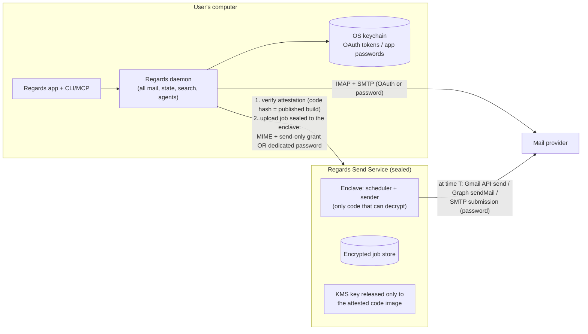

# ADR-0018: Modern, minimal 1.0: OAuth-first IMAP and a sealed Send Service

- **Status:** **Accepted** (2026-10-18). **Supersedes [ADR-0016](0016-v1-scope-imap-only.md)** (password-only 1.0) and **[ADR-0017](0017-send-when-off-relay-in-v1.md) §3–4** (self-hosted relay in 1.0, hosted-relay tracks). **Amended by [ADR-0019](0019-send-while-off-in-1-1.md):** the Send Service and Pro ship in **1.1**, not 1.0, and only the password-handling worker is sealed.
- **Date:** 2026-10-18 (revised the same day to cover password-only providers such as Infomaniak)
- **Deciders:** Project owner

## Context

The project owner wants the **most modern, most secure and simplest** design, since we start from scratch. Sending must work **while the computer is off, including for password-only IMAP providers** such as Infomaniak, which the owner uses.

1. **Spark's model is outdated.** Spark stores account passwords or tokens on its servers, readable by the operator, and polls mailboxes from there ([ADR-0017](0017-send-when-off-relay-in-v1.md)).
2. **Microsoft and Google issue send-only OAuth grants:** `Mail.Send` / `SMTP.Send`, and `gmail.send`, which is reported as a *sensitive*, not *restricted*, scope.
3. **Infomaniak (observed 2026-10-18).**
   - **Login methods:** `mail.infomaniak.com` advertises only `AUTH PLAIN LOGIN` on SMTP (587, after STARTTLS) and `AUTH=PLAIN AUTH=LOGIN` on IMAP (993). There is **no OAuth** and **no FUTURERELEASE**.
   - **Pre-login IMAP capabilities:** `IMAP4rev1 UIDPLUS IDLE LITERAL+ QUOTA`. There is no CONDSTORE, QRESYNC, MOVE or SPECIAL-USE before login; the list after login must be checked.
   - **Passwords:** Infomaniak supports **multiple independent, revocable passwords per mailbox**, separate from the account login.
   - **Scheduling:** its own webmail and apps schedule sends **server-side**, and they go out while the user is logged out. No public API for this was found.

   This was observed by reading the servers' public capability lists, without logging in.
4. **Confidential computing makes "a server that holds a password but cannot let its operator read it" practical.**
   - **Hardware enclaves:** AWS Nitro Enclaves, or AMD SEV-SNP / Intel TDX confidential VMs.
   - **Remote attestation:** the client can verify which code is running before handing anything over.
   - **Key policies bound to the measured code image:** for example AWS KMS `kms:RecipientAttestation:ImageSha384`, which ties a key to the enclave's PCR0 hash.
   - **Precedent:** Apple's Private Cloud Compute uses attestation with a public transparency log.

## Decision

### Three rules

1. **Full-access secrets stay on the device.** The single exception is opt-in: for password-only accounts, the user may give the Send Service a **dedicated, revocable mailbox password** (for example a separate Infomaniak password named "Regards Send"). It is **sealed** so only attested Send Service code can use it.
2. **Nobody at Regards can read credentials or mail.** The Send Service runs only **reproducibly built, open-source, attested code inside a hardware enclave**. Decryption keys are released only to that exact code.
3. **One local service, one protocol, one small cloud service.**

### Architecture

### 1.0 accounts and "send while the computer is off"

| Provider | Sign-in on the device | Send while off |
| --- | --- | --- |
| **Microsoft** | OAuth 2.0 + PKCE (required by Microsoft) | First choice: Exchange-held delayed delivery, if Exchange Online honours it through the API (**Phase-0 spike**). Otherwise the Send Service with a **`Mail.Send`-only** grant |
| **Google** | OAuth once Google approves the app (process **starts in Phase 0**); app password until then | Send Service with a separate OAuth client that requests **only `gmail.send`**. Before approval, the app-password path in the next row |
| **Password-only providers** (Infomaniak, iCloud, Yahoo, Fastmail, GMX, own server …) | App or mailbox password in the OS keychain | Server-side FUTURERELEASE where offered. Otherwise **opt-in**: a dedicated, revocable password **sealed to the Send Service**, which submits via SMTP at time T. Without opt-in, the computer must be on (background mode on by default) |

**Situations:**
- **Computer on, no internet at send time:** the email goes out when the connection returns, unless it was already handed to the provider or the Send Service, in which case it goes **on time**.
- **Computer off or asleep:** on time for every row above, provided the user has opted in for password accounts.

**Hand-off timing:** the hand-off happens at scheduling time. If the user schedules while offline, it happens when the device is next online.

**UI and agent wording:** the UI and the agent API always state what will happen: "will be sent even if your computer is off", or "your computer must be on at 09:00".

### Regards Send Service (sealed)

- **Single job:** "send this MIME at time T using this credential".
  - **Credentials:** a send-only OAuth refresh token, or a dedicated password used **only for SMTP submission**. The code never opens IMAP.
- **Sealing:**
  1. The device fetches the enclave's **attestation document**.
  2. It checks that the code measurement matches a **published, reproducible build**, listed in a public transparency log.
  3. Only then does it encrypt the job to the enclave.
  4. At rest, jobs are encrypted with a KMS key whose policy releases it **only to that measured image**.
  5. Operators, cloud administrators and database dumps see only ciphertext.
- **After sending:** the message is deleted immediately. The credential copy is deleted when the user has no pending jobs. The user can revoke any time: in Regards, and for passwords also at the provider (for example, delete the "Regards Send" password in the Infomaniak Manager).
- **Control:**
  - Jobs can be cancelled or rescheduled until the send claim is taken, with at-most-once semantics (ADR-0010).
  - Agent sends are approved on the device **before** upload (ADR-0012).
  - A per-user send rate limit applies, and the user is notified on every send.
- **Hosting and licence:** a confidential-computing host, for example an AWS Nitro Enclave on a small parent instance with KMS. Open source under AGPL (ADR-0004). Reproducible builds are mandatory.
- **Partnerships (no cost):** ask Infomaniak (and others) whether their **server-side scheduled send** can be exposed to third-party clients through an API or OAuth. Where it is, Regards hands the email to the provider itself, as with Microsoft, and the Send Service isn't needed for that provider.

### Who gets it (with ADR-0014)

- **Works with any email host.** The Send Service speaks standard **SMTP submission** for every IMAP/SMTP provider (hosting companies, Infomaniak, iCloud, Yahoo, own servers …), and the send-only APIs for Gmail and Microsoft. Nothing is provider-specific.
- **Free for everyone** (costs us nothing):
  - sending while the computer is on (background mode)
  - provider-held delivery: SMTP FUTURERELEASE, or Exchange-held delayed delivery if verified
  - **self-hosting the Send Service** in *personal mode*, on the user's own machine or server. Without an enclave, the device pins the server's key on first pairing (trust on first use), since users trust their own hardware.
- **Pro:** our hosted, **sealed** instance. It is attested, monitored and maintained, with a 30-day free trial. The UI offers Pro only at the moment it's relevant, when someone schedules an email that would otherwise need the computer on.

### Deferred, not part of 1.0

- The self-hosted relay (ADR-0017 §3), as an optional power-user alternative to the sealed service.
- Gmail API and Graph as full sync adapters (ADR-0009). Local sync stays IMAP in 1.0.

## Alternatives considered

- **Password-only 1.0 + self-hosted relay (ADR-0016/0017 as accepted).** Legacy authentication; Microsoft users are excluded; send-when-off requires users to run a server. Superseded.
- **Hosted relay with operator-readable passwords (Spark's model).** Rejected.
- **"Bring your own cloud"** (a one-click deploy of the sender into the user's own cloud account). Secure, but too technical for most users. Kept as an option alongside the self-hosted relay.
- **OS wake timers only.** Reliable on Windows, limited on macOS and with closed laptop lids. Possible complement, not a solution.
- **Third-party sending APIs and mailbox aggregators.** Rejected (see [ADR-0017](0017-send-when-off-relay-in-v1.md) alternatives).

## Consequences

- **Microsoft users** are supported in 1.0, at $0 cost.
- **Password providers such as Infomaniak** get send-while-off (in 1.1, [ADR-0019](0019-send-while-off-in-1-1.md)) without anyone at Regards being able to read their password.
- **Google approval time** becomes a schedule item. Gmail works with app passwords until approval.
- **Two Google OAuth registrations:**
  - the desktop client with a restricted scope; data stays local, so no CASA is expected
  - the Send Service with `gmail.send` only; sensitive, so verification but no CASA is expected

  **Confirm both with Google.**
- **More engineering in Phase 3 (size: L for the Send Service):**
  - a reproducible build pipeline for the enclave image
  - attestation verification in the client
  - a public transparency log of image hashes
  - KMS policy setup
- **Costs** (*estimates*; see [06](../research/06-costs-and-business-model.md)): a small always-on parent instance plus KMS, roughly **$20–60 per month**. Nitro Enclaves run on regular EC2 instances; check current pricing. On top of that: a privacy-policy review, and a security review of the enclave code before launch.
- **Remaining trust:** users trust the hardware vendor and cloud provider's enclave guarantees, and our published open-source code. Enclaves have had side-channel vulnerabilities historically. Defence in depth:
  - dedicated revocable passwords
  - send-only behaviour, with no IMAP code in the enclave
  - rate limits and per-send notifications
  - prompt revocation tooling
- **IMAP engine:** Infomaniak's pre-login capabilities show **no CONDSTORE/QRESYNC/MOVE**. The IMAP engine (ADR-0009) must stay efficient without them: UIDPLUS-based COPY + `\Deleted` + UID EXPUNGE for moves, periodic flag resync, and IDLE for new mail. Check after login with a test account.
- **Applied on acceptance (2026-10-18):** ADR-0016 marked *Superseded*; ADR-0017 marked *Partially superseded*; ADR-0009 and ADR-0011 status notes updated; the [plan](../research/03-independent-implementation-plan.md) rewritten (the Send Service + Pro is Phase 4); the [cost document](../research/06-costs-and-business-model.md) §1–8 aligned.

## References

- [Readdle on Spark's credential storage](https://readdle.com/blog/how-we-handle-your-account-information-in-spark)
- [AWS KMS condition keys for Nitro Enclaves](https://docs.aws.amazon.com/kms/latest/developerguide/conditions-nitro-enclave.html)
- [Apple Private Cloud Compute opened for public inspection](https://www.securityweek.com/apple-opens-private-cloud-compute-for-public-security-inspection/)
- [Edgeless Systems: PCC concepts and an open alternative](https://www.edgeless.systems/blog/apple-private-cloud-compute-core-concepts-and-an-open-alternative)
- [Infomaniak: schedule sending in Mail](https://www.infomaniak.com/en/support/faq/1449/schedule-sending-an-e-mail); [Infomaniak: mailbox passwords and IMAP/SMTP settings](https://www.infomaniak.com/fr/support/faq/2427/synchroniser-les-e-mails-sur-tous-vos-equipements); [Infomaniak: Thunderbird setup](https://infomaniak.com/en/support/faq/2430/set-up-thunderbird-in-imap-email)
- [EmailEngine: Gmail API scopes](https://learn.emailengine.app/docs/accounts/gmail/gmail-api-scopes); [Microsoft: PidTagDeferredSendTime](https://technet.microsoft.com/en-us/library/cc840017(v=office.14))
- RFC 4865 (FUTURERELEASE); RFC 7636 (PKCE); RFC 8252 (OAuth for native apps)
