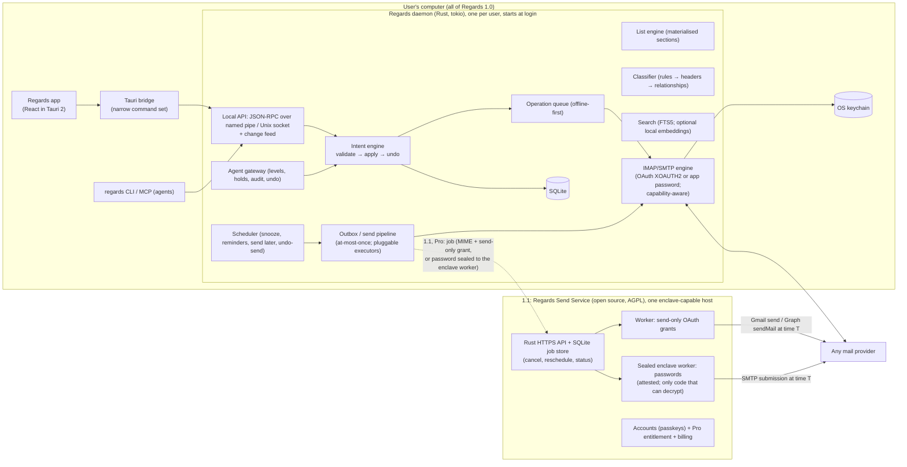

# Regards: implementation plan

**Status:** plan aligned with the accepted [Architecture Decision Records](../adr/README.md) (2026-10-18). Where this plan and an ADR differ, the ADR wins. Nothing has been implemented yet.
**Inputs:** the behavioural inventory in 02 (private research notes), architecture lessons from 01 (private research notes), the Alice assessment in [04](04-alice-compatibility-assessment.md), and costs in [06](06-costs-and-business-model.md).

**Key decisions:**

| Decision | ADR |
| --- | --- |
| Build from scratch with clean-room rules | 0001, 0003 |
| Rust core + Tauri 2 + React/TypeScript | 0002 |
| Windows, macOS and Linux all tier-1 | 0013 |
| One local daemon; named pipe or Unix socket | 0005, 0006 |
| Core-owned state, intents, undo, change feed | 0007 |
| OAuth-first IMAP/SMTP for 1.0 | 0018 |
| **1.0 is fully local** (no Regards servers); sending while the computer is off ships in **1.1** | 0019 |
| 1.1 Send Service: a small Rust HTTPS service, a normal worker for send-only OAuth grants, a **sealed worker for passwords** | 0019 |
| Free in 1.0; **Pro from 1.1** (the hosted Send Service first) | 0014, 0019 |

---

## 1. Goals and non-goals

**Goal.** An open-source, local-first desktop email client that delivers Spark-like *workflows* with our own design and code:

- a calm, sectioned Smart Inbox
- Done / Pin / Set aside / Seen
- snooze, reminders and send later (1.0: while the computer is on; **1.1: also while it is off**)
- pervasive undo
- new-sender screening
- an agent interface with real safety controls

**Not in 1.0:**

- sending while the computer is off (1.1)
- any Regards server, account or billing (1.1)
- team features
- a calendar application
- meeting transcription
- read-receipt tracking pixels
- cross-device sync and hosted AI (Pro, after 1.1)
- full Gmail API / Graph sync adapters
- mobile apps
- paywalls on local features: the app is identical for free and Pro users

## 2. Clean-room rules (ADR-0001)

1. **Specifications come from behaviour, not code.** They are written from 02 (private research notes), open standards and provider documentation. The standards: RFC 5322/2045 MIME, RFC 9051 IMAP4rev2, RFC 7162 CONDSTORE/QRESYNC, RFC 2177 IDLE, RFC 6851 MOVE, RFC 4315 UIDPLUS, RFC 4865 FUTURERELEASE, RFC 8058, RFC 3834, RFC 2369/2919, RFC 5546 iTIP, RFC 7636/8252 OAuth for native apps, and WebAuthn.
2. **Nothing copied** from Spark or Alice: no code, assets, UI text or identifier names. Coding agents never get access to those sources.
3. **No trademarks** of others in our product.
4. **No private interoperability** with Spark's backend or formats.
5. **Every significant decision is an ADR** citing public sources.

## 3. Architecture

### 3.1 Principles (re-expressed from what we observed)

| Observed in Spark | Our design |
| --- | --- |
| The core owns all state; the UI is a projection | The daemon is the single source of truth; clients subscribe to a **change feed** (no polling) |
| Actions are validated by the core | `Intent::validate` serves the UI, CLI and agents alike |
| 70 undoable action kinds | Every intent writes an inverse; undo is itself an intent |
| Materialised list membership | `thread_view` and `list_membership` projections, maintained incrementally |
| Offline flags and push-op queues | A durable operation queue with idempotency keys |
| Agent levels enforced in the core, holds, audit | The same model, enforced in the daemon |
| The backend holds readable account credentials | **Never**: 1.0 has no backend. In 1.1, send-only grants, plus passwords sealed to an attested worker |
| Electron fuses at defaults | Tauri with minimal capabilities, strict CSP, sandboxed reader, OS keychain only |

### 3.2 Process, transport and lifetime

- **One daemon per OS user** (ADR-0005), shared by the app, CLI and MCP.
- **Background mode is on by default**: the daemon starts at login and keeps running after windows close, with a tray or menu-bar indicator (ADR-0017 §1). In 1.0 this is what makes scheduled mail reliable.
- **Local transport:** a named pipe with a current-user DACL on Windows; a Unix socket (`0600`) on macOS/Linux. JSON-RPC with version negotiation and principals (`ui`, `agent`) (ADR-0006).

## 4. Data model (sketch)

| Table | Key fields |
| --- | --- |
| `accounts`, `identities` | provider kind, **auth kind** (`oauth_microsoft`, `oauth_google`, `password`), server capabilities (CONDSTORE, QRESYNC, MOVE, IDLE, UIDPLUS, FUTURERELEASE …), sync window; aliases and signatures |
| `mailboxes` | role (`inbox`, `archive`, `sent`, `drafts`, `trash`, `junk`, `snoozed?`), UIDVALIDITY, UIDNEXT, HIGHESTMODSEQ (when available), last full flag-resync time |
| `messages`, `message_locations` | `Message-ID`, `In-Reply-To`, `References`; per-mailbox UID/modseq; flags/keywords; body parts and attachment metadata |
| `threads` | JWZ-style References threading; Gmail thread ID when present; subject fallback |
| `thread_state` | `category` + `category_source`, `priority`, `pinned_at`, `done_at`, `aside_at`, `seen_at`, `snooze_until` / `snooze_someday`, `reminder_at`, `muted` |
| `sender_policies` | address or domain → screening status, category override, priority, grouping |
| `drafts`, `draft_revisions` | stable UUID, fields, HTML + text, attachments, `frozen_payload` hash |
| `outbox` | draft ref, `send_at`, `undo_until`, **`executor`** (1.0: `device`; 1.1 adds `provider`, `send_service`, `self_hosted`), state (`queued` → `handed_off` → `sending` → `sent` / `failed` / `uncertain`), remote job ID, receipt |
| `operations` | idempotency key, target, provider operation, attempts, `next_attempt_at`, last error |
| `undo_log` | intent, actor, inverse, `expires_at` |
| `agent_audit`, `agent_holds` | verb, args, targets, access level, before-state, decision, status |
| `send_service_pairing` (1.1) | service URL, pinned enclave measurement, device key, Pro entitlement cache |
| `search_*` | FTS5; optional `embeddings` |

## 5. Feature specifications (summary, with acceptance criteria)

### 5.1 Accounts and sign-in (P0, 1.0, ADR-0018)

- **Microsoft:** OAuth 2.0 + PKCE (loopback redirect), XOAUTH2 for IMAP/SMTP.
- **Google:** OAuth once Google approves the desktop client (the verification process **starts in Phase 0**); until then, guided app-password setup.
- **Everyone else** (Infomaniak, iCloud, Yahoo, Fastmail, GMX, hosting providers, own servers): an app or mailbox password in the OS keychain. Autoconfig through an ISPDB-style database, DNS SRV, then manual entry, with app-password guidance.
- **Accepted when:** setup succeeds against Microsoft 365, Outlook.com, Gmail (both paths), Infomaniak, iCloud and a self-hosted Dovecot, and no secret is ever written outside the keychain.

### 5.2 IMAP engine (P0, 1.0, ADR-0009)

- Async IMAP on rustls, one connection actor per account (an IDLE connection plus a command connection).
- **Library:** `imap-next` + `imap-codec` behind our own `regards-imap` crate, following the rules from the [spike](07-imap-library-spike.md) §7.
- **Built so far (Phase 1):**
  - **Mailboxes:** mailbox list with roles (SPECIAL-USE, then common names in five languages).
  - **First sync of a mailbox:** headers of the newest 2,000 messages. Older ones are then fetched in the background, newest first, 500 at a time, until every folder is complete; a batch is only stored under the UIDVALIDITY it was fetched with.
  - **Later syncs:**
    - **New messages:** by UID.
    - **Flag changes and deletions with QRESYNC:** one `SELECT (QRESYNC …)` reports changed flags and vanished UIDs since the last sync, so there is no extra FETCH and no full `UID SEARCH`.
    - **Without QRESYNC:** flags by `CHANGEDSINCE` with CONDSTORE, otherwise by re-reading the stored range; deletions only from a completed `UID SEARCH`.
    - **UIDVALIDITY changes:** rebuild the mailbox.
  - **Header parsing:** headers are fetched as literals and parsed with `mail-parser` (encoded words, legacy charsets).
  - **Tests:** CI runs these flows against Dovecot.
  - **Push:** one IDLE connection per account on the inbox, with a catch-up sync before each IDLE, re-IDLE every 25 minutes, and reconnect with backoff (reset once a connection worked). Servers without IDLE are polled every 5 minutes. Measured against Dovecot: about 0.6 s from delivery to the store.
  - **Offline:** a fault-injection proxy test cuts the line. Actions taken offline show at once, and when push reconnects the waiting actions go out at once (about 5 s after the line returns, against 9 s or more on the retry schedule).
  - **Scale:** a 100k-message fixture (`cargo test -p regards-store --release --test scale -- --ignored --nocapture`). Storing it: 2.7 s, at most 80 ms per batch of 2,000. Afterwards, any page of the list: about 0.3 ms (12 ms cold); a conversation or a message row: under 0.2 ms; a 50-message action: 0.2 ms; reopening the store: 7 ms cold.
  - **Connections:** addresses are tried "Happy Eyeballs" style (RFC 8305), so a broken IPv6 route costs 250 ms, not seconds.
  - **Live updates in the UI:** a change feed (ADR-0007) notifies subscribed clients of every committed change and sync-status change. The app refreshes on those events and no longer polls.
  - **Conversations:** References threading across folders (ADR-0009 §5). The reading pane lists the other messages of the conversation, wherever they are, and opens them.
  - **Reading:** the source is downloaded once (`BODY.PEEK[]`, so it stays unread) and kept in `blobs/`. HTML is sanitised and shown in a sandboxed frame, with remote images blocked until allowed. Web links open in the default browser (ADR-0006 §4).
  - **Actions:** read/unread, flag, archive, delete (to Trash), move, and delete for good (from Trash or Junk) go through the operation queue. They show at once, reach the server in the background, are retried while offline, and moves can be undone.
  - **Keyboard:** Gmail-style shortcuts (`j`/`k`, `e`, `#`, `s`, `Shift+U`/`Shift+I`, `z` to undo, `Esc`), with `?` for the list. Customisable sets come with settings.
- **Still to come in Phase 1:**
  - **Sign-in:** OAuth (XOAUTH2) for Microsoft, and Google behind a flag until approved; this needs the app registrations (Phase 0 paperwork).
  - **Live tests on real providers:** Microsoft 365, Outlook.com, Gmail, Infomaniak and iCloud.
- **Capability-aware:** incremental flag sync with CONDSTORE/QRESYNC; efficient UID-range sync plus periodic flag resync without them (Infomaniak advertises neither before login; recheck after login). MOVE, or UIDPLUS COPY + `\Deleted` + UID EXPUNGE.
- Gmail X-GM-EXT-1 labels and thread IDs when present.
- **Accepted when:** the fault-injection suite passes with no panics on malformed input, and IDLE delivers new mail in under 5 s.
  - **Status:** IDLE delivers in about 0.6 s against Dovecot. A hostile fake server answers every kind of command with 16 kinds of bad replies (noise, a 4 GB literal that never comes, truncation, an endless line, BYE, wrong tags, junk numbers and names), and each call ends in a result or an error within seconds, never a panic or a hang. 3,000 mangled messages and degenerate inputs go through every message parser without a crash. The offline proxy test covers lost connections. Real-provider runs are still to do.

### 5.3 Inbox and navigation (P0, 1.0)

- **Scope:** unified and per-account inboxes, system mailboxes, folders/labels, Outbox, Snoozed, Set aside, Recently seen; split layouts; keyboard-first navigation; context menus.
- **Accepted when:** 10k-thread lists scroll at 60 fps, every action is keyboard-reachable, and the layout persists per window.
- **Built so far:**
  - **Window:**
    - The sidebar is kept open beside the mail, or folded to a dark rail of icons that opens over it (`/`).
    - Split view puts the list and the open message side by side (the default); a message can also open in place of the list, with a way back.
    - On Windows the app draws its own title band, with an app menu (⌄), minimise, maximise and close; macOS keeps its traffic lights over the sidebar.
    - The layout and the theme (light, dark or as the system) are remembered.
  - **Sidebar:**
    - Inbox (with its unread count, and per account under a chevron when there are several), then Pinned, Drafts, Sent, Trash and the Outbox (with its count).
    - Under Folders: Archive, the folders added with a star, and More. More opens a panel of every folder: Snoozed, Reminders, Set aside, Junk and anything taken out of the sidebar, then each account's folders. The star adds one to the sidebar; Ctrl+click adds several.
    - Folders opened from the panel are listed under Recents (with Clear). Right-clicking a folder removes it from the sidebar, or pins a recent one.
    - Messages can be dragged onto a folder: Archive, Trash, Junk, a folder of their account, Pinned, Set aside, Snoozed or Reminders.
  - **The list:**
    - Grouped by day (Today, Yesterday, This week, Last week, then by month).
    - Beside the reader, three lines per message: who and when; the subject, the conversation's size and a paperclip; the start of the text. Hovering shows Done, read/unread and delete in the margin. The open message is tinted across the row.
    - Alone, one line per message, with the actions in place of the date on hover.
    - Set-aside mail waits in a bubble at the bottom left.
    - Several can be selected (Ctrl/⌘-click, Shift-click, `x`, Ctrl/⌘+A, or the check when the list is alone). A bar at the top then acts on all of them.
    - Single-key shortcuts act on the selection, else the message under the pointer, else the highlighted one.
    - Search (Ctrl/⌘+F, the magnifier, or the palette) takes the header's place and searches all mail (§5.10).
  - **Reading:** a toolbar with Back | Done, then delete, flag, read/unread, pin, set aside, snooze and ⋯; the subject below it; the conversation as cards, oldest first, the open message expanded. Reply and forward sit at the bottom of each card, and after archiving or deleting the next message opens.
  - **Writing:** a new message takes the whole pane, with a large subject field. A reply opens in a panel over the conversation, which can be made full size.
  - **The command palette** (Ctrl/⌘+K, right-click on a message, and every ⋯): the actions on that message, conversation or selection, with their keys, then going to any folder and the app's commands. Moving, snoozing, reminders and sending later open as pages of it.
  - **Actions** come from one list, which feeds the toolbar, the hover buttons, the selection bar, the palette and the shortcuts.
  - **Still to come:**
    - one row per conversation
    - a virtualised list for 10k rows
    - reordering the sidebar by dragging

### 5.4 Smart Inbox (P1, 1.0)

- **Sections:** Priority · People · New senders · Notifications · Newsletters · Pinned · Seen (optional Invitations), rendered as cards with item limits and bulk actions.
- **Deterministic, explainable classifier:**
  1. user overrides and sender policies
  2. headers
  3. the relationship graph
  4. priority senders and threads
  5. optional local ML later
- **New-sender screening:** *off* / *section* / *hold until accepted*; accept or block a sender or domain.
- **Accepted when:** every placement answers "why is this here?", corrections persist, and nothing leaves the device.
- **Built so far (Phase 4):**
  - **The rules** (`regards_core::smart::classify`) run in order, and the first that applies wins:
    1. the section the person chose for the sender
    2. priority sender
    3. from one of the account's own addresses (People)
    4. delivery report, sent automatically, or no-reply address (Notifications)
    5. mailing list or bulk (Newsletters)
    6. sent through a bulk-mail service (Notifications)
    7. someone the account has written to (People)
    8. anyone else (New senders)
  - **One function gives the section and the reason**, so "why is this here?" (`message.explain`) cannot disagree with the placement.
  - **Header traits:** the sync also fetches `List-Id`, `List-Unsubscribe`, `List-Post`, `Precedence`, `Auto-Submitted`, `X-Auto-Response-Suppress`, `X-Autoreply`, `Content-Type` and `Feedback-ID`. From them each message gets traits as bit flags. A twelve-case corpus test covers newsletters, receipts, code-review notifications, bounces, auto-replies and people.
  - **State (migration 0017):**
    - every message's `section`, kept current
    - a `senders` table per account: the person's choice, priority, and when the account first wrote to them
  - **The relationship graph:** a message from one of the account's addresses marks its recipients as written to, and their New senders mail moves to People. The migration seeds this from mail already stored.
  - **Mail stored before** is sorted at start from what is known. The backfill then reads the inbox's headers again, newest first.
  - **API:**
    - `message.list` takes a `section`; its page walks `messages_by_section`
    - `smart.overview` gives counts and unread per section
    - `sender.set` records a correction, and the sender's mail, old and new, follows it
  - **Domains:** a correction can name a whole domain (`@shop.example`); a choice for an address wins over its domain's.
  - **Screening** (`smart.screening`, migration 0019):
    - **off:** New senders fold into People
    - **section:** the default
    - **hold:** the inbox leaves New senders out until accepted (a `people` choice); their section is the screener
  - **Blocking** (`sender.block`, an address or a domain):
    - the sender's inbox mail moves to Junk on the server, through the queue
    - what they send later goes there as it arrives
    - undo brings the mail back and unblocks
  - **App API:** `smart.ts`, with `reasonText` for the "why is this here?" sentences.
  - **In the app:**
    - The inbox's title chooses its view: **Smart** (the default) or **By date**, shown as two pictures. With several accounts it also chooses all of them or one; the Smart Inbox then covers that account only.
    - **Smart**, top to bottom:
      - new senders, as a card whose rows have Accept and Block (or, when held, one line that leads to them)
      - a warm Priority card with its newest three and "View all"
      - People by day, with one row each for Notifications, Newsletters and Pinned in the first day: an icon, a count, and the senders as chips
    - Each group opens as its own list, with a way back (Esc).
    - **The sender card** opens from a message's face, or from the palette. It shows where their mail goes (automatically, or always People, Notifications or Newsletters), a Priority switch, the "why is this here?" sentence, Write to them, copy the address, and Block or Unblock.
    - **Settings › Smart Inbox** holds the view, and new senders: with everyone, in a card, or held back.
    - **Still to come:**
      - bulk actions on a card
      - choosing which groups are bundled
      - the card view (unread mail as stacked cards)

### 5.5 Done / Pin / Set aside / Seen (P1, 1.0)

- **Done** = archive.
- **Pin**, **Set aside** and **Seen** are local overlays.
- Everything is undoable and agent-callable, with identical semantics in the UI, CLI and MCP.
- **Built so far (Phase 3):** Pin and Set aside are kept on the device, keyed by account and Message-ID, so they follow a message across folders, moves and resyncs (migration 0012). The inbox leaves out what is set aside or snoozed; other folders show everything. The Pinned, Set aside and Snoozed views list one entry per message. Marking is undoable like moves (`message.pin`, `message.set_aside`, `message.view`). Measured on the 100k fixture: an inbox page with 100 messages set aside takes 0.3 ms. Done is archive. The buttons come with the new app shell.

### 5.6 Snooze and reminders (P1, 1.0, ADR-0011)

- **Snooze:** presets plus a custom time plus Someday. Wake-up returns the thread as new, with an optional notification. A new message cancels the snooze. Storage is a local overlay, with an optional server-visible `Snoozed` mailbox.
- **Reminders:** "if no reply by …", cancelled by any reply from another participant.
- **Executed on the device only**, in every release: nobody looks at the inbox while the computer is off.
- **Accepted when:** these work across restarts, DST, time-zone changes and sleep/resume.
- **Built so far (Phase 3):**
  - **Snooze:** until a time or "someday" (`message.snooze`, undoable). Snoozed messages leave the inbox and are listed in the Snoozed view.
  - **The scheduler** (one daemon task) never sleeps more than 30 s before reading the wall clock again, so sleep, clock and time-zone changes delay a wake-up by seconds. Overdue snoozes wake at startup.
  - **Waking** marks every copy unread, here and on the server, so it is back as new.
  - **Replies:** new mail from someone else in the conversation ends a snooze. "New" means stored by an incremental sync, never compared across the server's and the device's clocks; first syncs and backfill don't count.
  - **Presets** (later today, this evening, tomorrow, this weekend, next week, someday) are built from local dates and hours, so they keep wall-clock times across DST. Unit-tested (Vitest) in a fixed zone with an October change.
  - **Back on top:**
    - A woken snooze records `surfaced_at` (migration 0014), and the inbox lists it by that time, so it is on top, not back at its old date.
    - Summaries carry `listed_at`, and the inbox cursor pages by it.
    - The inbox query gains a third half that walks `marks_surfaced`. It takes 0.74 ms per page at 100k messages with 100 messages come back (`tests/scale.rs`).
  - **Reminders:**
    - `message.remind` (undoable) takes a time, or none. They can also be set when sending: `draft.send` takes `remind_at`, keyed by the new Message-ID; undo send drops it.
    - **When the time comes:** if someone else has written in the conversation since the message, the reminder just goes. That check compares two server arrival times, never the device's clock.
    - **Otherwise** the message is "reminded": shown on top of the inbox from wherever it is filed (Sent, usually), with a Reminders view for those still waiting.
    - **A reply** arriving by incremental sync also ends a waiting or come-due reminder, as with snooze.
    - **Done:** archiving a reminder shown outside the inbox ends it, and the message stays filed. Any move clears the "came back" marks, undoably.
  - **Notifications:**
    - **What is recorded:** the daemon records notices (migration 0015) when a snooze ends, a reminder comes due, or a send is held, failed or uncertain. Each carries who and the subject, never the text, and they are kept a week.
    - **What the desktop does:** it lists unshown notices (`notice.list`) after changes and at start, shows them as OS notifications (`tauri-plugin-notification`), and marks them shown (`notice.shown`).
    - **How many:** up to three, one each; more become one summary, which covers ADR-0011's summary after downtime.
    - **When not shown:** while the window has the focus, or when turned off in the tray ("Show notifications"). Either way they are marked shown.

### 5.7 Send later, undo send and executors (P1)

- **Undo send (1.0):** every send passes through the outbox with `undo_until = now + delay` (default 10 s, configurable 0–30 s).
- **Freezing and at-most-once (1.0):** MIME bytes are frozen and hashed at queue time, and exactly one executor claims the job. A timeout becomes `uncertain`, with no blind retries, and is reconciled with the Sent folder.
- **No internet (1.0):** the Outbox holds messages and sends them when the connection returns.
- **Executors:**

  | Executor | Release | Who | Covers |
  | --- | --- | --- | --- |
  | **Device** (background mode on by default) | **1.0** | Free | Computer on. UI wording: "your computer must be on at 09:00"; catch-up rules after downtime (ADR-0011) |
  | **Provider-held**: SMTP FUTURERELEASE; Exchange-held delayed delivery if the spike confirms it | 1.1 | Free | Computer off, where the provider supports it |
  | **Self-hosted Send Service** (personal mode) | 1.1 | Free | Computer off; the user's own server |
  | **Regards Send Service** | 1.1 | **Pro** (30-day trial) | Computer off, **any email host** |

- **Agents:** agent-scheduled sends go through holds on the device (ADR-0012). In 1.1, approval happens **before** hand-off to any remote executor.
- **Accepted when:**
  - **1.0:** sends are on time while the computer is on, and catch-up is correct after sleep or shutdown, with no duplicates under fault injection.
  - **1.1:** a scheduled email is delivered on time **with the laptop asleep** for Microsoft, Gmail, Infomaniak, iCloud and self-hosted Dovecot.
- **Implementation (Phase 3, device executor):**
  - **Schema (migration 0013):**
    - The outbox gains `send_at` and `executor` (`device` in 1.0).
    - It gains a `held` state.
    - The CHECK constraints already allow the 1.1 executor names and `handed_off`, so 1.1 needs no table rebuild.
  - **Sending later:**
    - `draft.send` takes `send_at`: a future time, at most five years ahead.
    - The bytes are frozen with `Date` set to that time, so the message does not arrive looking old.
    - The device runner claims only `device` entries, once both the undo window and `send_at` are past.
    - It naps at most 30 s, so it notices sleep and clock changes.
  - **Catch-up:** a scheduled entry found more than the grace (1 h, `Daemon::with_late_send_grace`) past its time becomes `held`, never sent unasked. A message sent "now" is never late, however long it waited offline.
  - **The person's choices:**
    - `outbox.reschedule` moves a queued or held entry to a new time or to now. It re-freezes the bytes from the frozen draft, re-dated, with the same Message-ID.
    - `outbox.undo` takes it back to its draft.
    - "Send again" after a failure clears `send_at`.
  - **UI:** the Outbox says "Sends Mon 19 Oct, 09:00. This computer must be on then." and, for held entries, offers **Send now** and **Edit**.
  - **Tests:** `tests/send_later.rs` runs against fake IMAP and SMTP, in CI. It covers:
    - not before its time, and dated for then
    - move, send now and take back
    - a restart after downtime, where the entry well past its time is held and the one a little late goes

### 5.8 Send Service and Pro (P1, 1.1, ADR-0018/0019)

- **API:** a small **Rust HTTPS service** with an embedded **SQLite** job store: create, cancel, reschedule and status-feed jobs.
- **Workers:**
  - **Normal isolated worker** for send-only OAuth grants (Microsoft `Mail.Send` / `SMTP.Send`, Google `gmail.send`), with grants encrypted at rest under a KMS-managed key.
  - **Sealed enclave worker** for passwords. The device verifies its **attestation** (a reproducible build listed in a public transparency log) and encrypts a dedicated password to it. Only that worker can decrypt; it runs SMTP submission and deletes the job.
- **Hosting:** one enclave-capable host. The API and the normal worker run on the host, the sealed worker in its enclave. A Swiss or EU region is preferred (verify availability).
- **Lifecycle:** messages are deleted after sending; credential copies are deleted when no jobs are pending; credentials are revocable in Regards and at the provider. A per-user rate limit applies, and every send is notified.
- **Account service:** passkey sign-in plus an email address for receipts; device pairing; entitlement; 30-day trial.
- **Billing:** a merchant of record.
- **Personal mode** (free self-hosting): the same service without an enclave; the device pins the server key on first pairing.
- **Accepted when:**
  - wrong enclave measurements are rejected by clients
  - KMS denies decryption outside the enclave
  - an external security review passes
  - the privacy policy, terms and data processing agreement are published

### 5.9 Drafts and composer (P0/P1, 1.0)

- **Editor:** a rich HTML editor (ProseMirror-based, for example Tiptap, or Lexical), with sanitised HTML + `text/plain`, inline images, attachments, per-identity signatures and quote handling.
- **Saving:** local revisioned autosave plus throttled IMAP draft sync.
- **Sources:** reply, reply-all, forward, send again, `mailto:`, templates with placeholders, and Markdown input for the CLI and agents.
- **Send validation:** recipients, subject (or confirmation), attachments ready, no unresolved placeholders.
- **Built so far (Phase 2):**
  - **Sending:** the SMTP submission client (`regards-smtp`, at-most-once).
  - **Drafts:** stored in the daemon. A new message, reply and reply all (Reply-To honoured, my own addresses left out) and forward start addressed and quoted. A reply's References are kept to 20 (the root and the latest).
  - **Outbox:** frozen MIME, undo send (10 s by default, 0–30 s), retry with backoff, `failed` and `uncertain` states, the Sent copy, and `\Answered` on the original (ADR-0010 §3–4).
  - **The composer in the app:** new message, reply, reply all and forward; Cc/Bcc; autosave; a list of drafts; undo send; the Outbox with its actions.
  - **Attachments:** picked with the system dialog and read by the daemon (ADR-0006 §4), at most 25 MB per message, frozen into the MIME at send. A forward carries the original's files (not its inline images).
  - **Formatting:** a Tiptap (ProseMirror) editor with bold, italic, underline, strikethrough, links, lists and quotes. The daemon sanitises the HTML (an allowlist of formatting tags; web and mail links only) and derives the text part from it, so a message goes as `multipart/alternative`. The editor loads on demand, and ProseMirror's styles ship as a file because the app's CSP allows no injected styles.
  - **Identities and signatures:**
    - **What they are:** an account sends as its own address (the default at first) or an alias. Each has a name and a plain-text signature, in migration 0016 and `identity.*`.
    - **New drafts:** a new message, reply or forward starts with the identity's signature, above any quote.
    - **Replies:** a reply goes out from the address it was written to, and none of the account's addresses is answered.
    - **Changing From** in the composer swaps the signature: the daemon swaps it in plain text (`draft.set_from`), the app in the editor's HTML.
    - **What changes on the wire:** the envelope, From and the Message-ID's domain follow the identity.
  - **Templates:**
    - **Storage:** text to start a message with, by name, for every account (migration 0020, `template.*`). Formatting is sanitised like an outgoing message's.
    - **In the composer:** a template goes where one writes, above the signature and any quote, and fills an empty subject.
      - The templates button, or Ctrl/⌘+Shift+T, opens them as a palette page, filtered by typing their name.
      - The same page keeps what has been written as a new template, named after its subject, formatting included.
    - **Settings › Templates:** an editor (`TemplatesEditor`) for them. It sits beside Inbox, as in the reference app's settings groups.
  - **IMAP draft sync:**
    - **Upload:** a draft left alone 5 s is appended to the server's Drafts folder (`\Draft \Seen`, with its Bcc), and its previous copy is deleted. Every copy carries one Message-ID (migration 0021).
    - **Deletion:** a trigger queues the copy whenever the draft goes (sent, discarded, account removed).
    - **Reconciliation:**
      - A copy gone from the server takes an unchanged draft with it (sent elsewhere); a changed draft is uploaded again.
      - Stray copies from a crash are deleted.
    - **Drafts from webmail or another device** are listed (`draft.elsewhere`) and picked up (`draft.adopt`).
    - **Servers without UIDPLUS:** drafts stay on the device.
- **Still to come in Phase 2:** checking the HTML in major clients (the acceptance test), inline images, and dropping files onto the composer.

### 5.10 Search (P0 keyword, P2 semantic, 1.0)

- Gmail-style query language over SQLite FTS5 with BM25.
- Optional on-device embeddings, opt-in.
- **Keyword search, as built (2026-10-19):**
  - **The language** (`regards_core::search`):
    - Words match the subject, the people and the text; the last one also as the start of a word (from two letters), so results come while typing.
    - `"a phrase"` matches as written, `-word` leaves out.
    - `from:` `to:` `subject:` look in one place; `has:attachment`; `is:unread` `is:read` `is:flagged`; `before:` / `after:` `YYYY-MM-DD`.
    - `in:<folder or role>`; Trash and Junk are left out unless named, or with `in:anywhere`.
    - Accents need not be typed. What is typed never reaches FTS5's own syntax: every word is quoted.
  - **The index** (`search.db`, ADR-0008): a row per stored message, with its subject, sender, recipients and text. The text is the whole of it once the message was downloaded (on opening), its preview before. Full texts are kept by Message-ID, so a message moved to another folder is still found by them.
  - **Kept current:** triggers on the writer queue every change to `messages`. The daemon indexes the queue 300 ms later, in batches of 500, with writes that wake no client. Another index version is rebuilt the same way, newest first.
  - **Results:** one copy of each message (its inbox copy first), newest first, paged like a folder. On the first page of words that match at most 2,000 messages: the 3 best by BM25 (the subject weighs most, then sender, recipients, text).
  - **Two plans:** words with few matches are read through the index. Common words, and filters alone, walk all mail newest first through `messages_by_time` (migration 0022) until a page is full; that index holds the filtered columns, so the walk reads only the index.
  - **Measured** at 100k messages (`tests/scale.rs`, release build, development machine):
    - Every query took 0.3–22 ms: a rare word 3 ms, a word in 88% of mail 22 ms, the whole walk (nothing passes the filters) 15 ms. The target is 150 ms p95.
    - Indexing 100k took 11.7 s in the background, each batch under 0.45 s.
  - **Interfaces:** `search.query` (`ui` only until agent access levels), bridged as `search_messages`, and `search.ts` in the app.
  - **In the app:**
    - Ctrl/⌘+F, the list's magnifier, or "Search mail" in the palette turns the list's header into a search field. With several accounts, the field also chooses all of them or one.
    - **Before typing:** tips to click into the field (from:, to:, subject:, in:, has:attachment, is:unread, after:, phrases and -word), and recent searches, each removable.
    - **Results** come as typing pauses (200 ms), through the same list as a folder, so rows, keys, selection and actions all work.
      - Above them: how many, and, while changes are still being indexed, that recent mail may be missing, with "Search again".
      - When there are more than a few, the best three come first as "Top results".
    - **Remembering:** Enter remembers the search and goes to the first result. Opening a result remembers it too.
    - **The sender card** has "Search mail from them".
    - **Search on the server**, offered beside the count and when nothing is found here, asks `search.server` for the same words and scope.
      - Its matches join the results, once each.
      - Then a line says how many it added, how many are on the server but not on this device yet, and which accounts could not be reached.
      - Older matches come with "More from the server", on demand, since each page asks the servers again.
  - **On the servers** (`search.server`, for a "Search on the server" action):
    - The same words and filters go to each account's server as IMAP `UID SEARCH` (`TEXT`, `FROM`, `TO` or `CC`, `SUBJECT`, `NOT`, flags, `BEFORE` / `SINCE`; `CHARSET UTF-8` when needed). This finds the text of mail not opened here.
    - It searches the folders the search would, but only All Mail when the account has one and no folder is named.
    - Matches stored here are listed like the search's results. Matches not fetched yet are counted (`not_here`), not fetched: storing an old message early would make older mail's background fetch skip what lies between.
  - **Not yet:** typo tolerance (ADR-0008's side index).

### 5.11 Agent gateway: CLI + MCP (P1, 1.0, ADR-0012)

- **Access levels** per account: Off (default) · Read · Triage · Send, enforced in the daemon.
  - **As built (2026-10-19), Read:**
    - Each account has `agent_access` (migration 0023), Off by default. Only the app sets it (`account.set_agent_access`).
    - The daemon checks it for every agent request, by the account the request names, or the mailbox's or the message's account.
    - Agents list only accounts open to them, and their searches, local or on the server, look only there.
    - A refusal names the setting (`data.setting = "agent_access"`, with the level needed and the current one). An account closed to agents is not named in it.
    - Read opens accounts, folders, message lists, the Pinned / Set aside / Snoozed / Reminders views, messages and conversations, Smart Inbox counts and explanations, and search. Reading never marks mail read.
    - Triage and Send come with the audit log and holds; until then, everything else stays with the app.
  - **In the app (Settings › Agents):**
    - Each account has a dropdown of the four levels, and the chosen one is explained under the address.
    - Choosing Send asks first.
    - Triage and Send are marked as coming until they take effect.
    - The page sits at the top of the settings, under the person's card, where the reference app keeps its AI agents.
- **Holds** for send-tier and bulk or destructive intents.
- **Audit log** with before-state and undo.
  - **As built (2026-10-19):**
    - Every agent request but the handshake is recorded once answered (migration 0024): when, the connection and what it came through (CLI, MCP), the method and its parameters, the account it named and what that account allowed then, the decision (allowed or denied), any error, and how long it took.
    - Secrets (keys naming a password, secret or token) are taken out of the parameters, and long ones are cut at 4 KB.
    - Records are quiet writes, so an agent's requests do not make clients refetch. The app lists them (`agent.activity`, newest first, by account), and they are kept 90 days.
    - Before-state and undo come with Triage, the first level that changes anything.
- **Interfaces:** stable `--json` contracts, `regards mcp`, `regards skill`, and deep links `regards://…`.
- **Prompt-injection posture:** content is passed as data, drafts never auto-send, and agents cannot change their own access.

### 5.12 Notifications, tray, badges (P1, 1.0)

- Only Priority and People notify by default.
- Snooze and reminder returns notify.
- From 1.1, every remote-executor send notifies.
- Unread counts appear in the tray.

## 6. Roadmap

The sizes are relative, not time estimates. Each phase ends with a usable build.

### To Regards 1.0 (fully local, Free)

| Phase | Theme | Main deliverables | Exit criteria | Size |
| --- | --- | --- | --- | --- |
| 0 | Foundation | Workspace from scratch: • CI on Windows/macOS/Linux with `cargo-deny` • daemon skeleton with lock and build handshake • pipe/socket JSON-RPC with principals • typed errors, generated TS types • keychain vault • mail fixtures (Dovecot/Postfix) • signing set-up (SignPath for Windows, free; Apple Developer ID optional, $99/year, when funded) • logging without third-party telemetry  Accounts and paperwork: • **Microsoft app registration** + publisher verification • **start Google OAuth verification for the desktop client** (domain, privacy statement, demo video) • ask Google to confirm in writing that CASA does not apply to a local-only client  Spikes: • IMAP crate (done: imap-next, see [07](07-imap-library-spike.md)) • migrations library (done: rusqlite_migration, ADR-0008) • Infomaniak post-login capabilities | Green CI on all three OSes; a hello-world build runs natively on each (signed on Windows); spikes concluded with ADR updates | M |
| 1 | Sync reliability | Capability-aware async IMAP engine (5.2), OAuth XOAUTH2 (Microsoft; Google behind a flag until approved), normalised schema and migrations, References threading, operation queue, intent engine, change feed | Airplane-mode test passes; IDLE under 5 s; 100k-message fixture responsive; live tests on Microsoft 365, Outlook.com, Gmail, Infomaniak and iCloud | XL |
| 2 | Composer | Compose model, rich HTML editor, attachments, identities and signatures, templates, IMAP draft sync, **undo send** | HTML round-trip renders in major clients; undo send is reliable | L |
| 3 | Inbox workflow + scheduling on the device | Done/Pin/Aside/Seen, snooze, reminders, Outbox + **send later (device executor)**, background mode by default, pluggable executor interface (ready for 1.1) | All workflow intents undoable; DST, sleep and catch-up tests pass | L |
| 4 | Smart Inbox | Classifier, sections and cards, screening, priority senders, grouping, bulk actions, "why is this here?" | ≥ 95% agreement on a header-derivable labelled corpus; corrections persist | L |
| 5 | Agents | Access levels, holds and approval UI, audit log + undo, CLI/MCP parity, agent skill | Prompt-injection red team passes; no send without Send level; local-transport security review | M |
| 6 | Search & AI | FTS5 search, optional on-device embeddings, BYOK assistant | Keyword search over 100k messages under 150 ms p95 | M |
| 7 | **Release Regards 1.0** | Signed installers and auto-update on all OSes, accessibility audit, a privacy statement ("Regards 1.0 runs no servers and collects no data"), and a website with an honest per-provider table, including "scheduled mail needs your computer on (until 1.1)". Google OAuth goes live if approved; otherwise the app-password path ships, and OAuth is switched on later without a release | 1.0 released free on Windows, macOS and Linux | L |

### Regards 1.1: sending while the computer is off, and Pro

| Phase | Theme | Main deliverables | Exit criteria | Size |
| --- | --- | --- | --- | --- |
| 8 | Send while off + Pro | **Spikes:** Exchange-held delayed delivery; enclave + attestation + KMS policy (region availability). **Free executors:** SMTP FUTURERELEASE, Exchange-held delivery (if confirmed), self-hosted Send Service (personal mode). **Send Service:** Rust HTTPS API + SQLite job store, normal worker for send-only grants, **sealed enclave worker** for passwords (reproducible image, transparency log, client attestation checks, KMS policy). **Pro:** register the `gmail.send`-only Google client; passkey account service, entitlement and 30-day trial, merchant-of-record billing. **Launch:** external security review; privacy policy, terms and data processing agreement | A scheduled email is delivered on time with the laptop asleep for every provider in 5.7; negative attestation tests pass; first Pro subscribers | XL |

**After 1.1:**
- Pro gains encrypted cross-device sync, hosted AI and priority support.
- Full Gmail API and Graph sync adapters, then JMAP.
- Optional OS wake timers.
- Mobile apps.
- Teams tier.

## 7. Testing strategy

- **Protocol:**
  - Containerised Dovecot/Postfix with capability profiles (with and without CONDSTORE, QRESYNC, MOVE and FUTURERELEASE).
  - A fault-injection proxy.
  - Recorded OAuth flows.
  - A **live provider matrix**: Microsoft 365, Outlook.com, Gmail, Infomaniak, iCloud.
- **Domain:**
  - Property tests for intent → inverse.
  - Scheduler DST, sleep and catch-up tests.
  - At-most-once send under injected crashes (1.0: device; 1.1: across device, provider and Send Service).
- **Send Service (1.1):**
  - Attestation verification (wrong measurement rejected, log inclusion required).
  - KMS denial outside the enclave.
  - Credential deletion.
  - Rate limits.
- **UI:** component tests, Playwright against the dev web build, keyboard-only flows, and visual regression on WebView2, WKWebView and WebKitGTK.
- **Agent:** CLI JSON contract tests, MCP conformance, and a prompt-injection corpus.

## 8. Key risks

| Risk | Mitigation |
| --- | --- |
| Users expect send-while-off in 1.0 | Clear wording in the composer and on the website; background mode on by default; 1.1 is the next release |
| Google verification takes long | Start in Phase 0; the app-password path keeps Gmail working; OAuth switches on without a release |
| Servers without CONDSTORE/QRESYNC/MOVE (for example Infomaniak) sync slowly | Capability-aware engine; a benchmark with a no-extensions profile |
| (1.1) Exchange-held delayed delivery does not work through the API | The Send Service with `Mail.Send` covers Microsoft anyway |
| (1.1) Enclave worker complexity | Only a few hundred lines are sealed; spike first; personal mode as a fallback; external security review |
| (1.1) Enclave side-channel history and trust in the cloud and hardware vendor | Dedicated revocable passwords, send-only code, rate limits, per-send notifications, fast revocation |
| (1.1) Providers challenge SMTP logins from data-centre IPs | Test the provider matrix; fall back to the device and tell the user |
| (1.1) Pro revenue doesn't cover Send Service costs | Low running cost (about $20–40/month); break-even estimates in [06 §1b](06-costs-and-business-model.md) |
| WebKitGTK rendering on Linux | Visual regression tests from Phase 0; Electron fallback documented (ADR-0002) |
| Clean-room contamination | ADR-0001 rules; no Spark/Alice sources available to coding agents |
| Prompt injection via email | Data/instruction separation, holds, no auto-send, audit + undo |

## 9. Decisions

**Resolved (2026-10-18):**

| Question | Answer | ADR |
| --- | --- | --- |
| Foundation | From scratch; Alice is a design reference only | 0003 |
| Stack | Rust core + Tauri 2 + React/TypeScript | 0002 |
| Platforms | Windows, macOS, Linux tier-1 from day one | 0013 |
| Product name | **Regards** (trademark clearance search pending) | 0004 |
| 1.0 sign-in and sync | IMAP/SMTP for every account; OAuth for Microsoft and Google (Google once approved); app passwords elsewhere | 0018 |
| 1.0 scope | Fully local, no Regards servers; scheduled mail sends while the computer is on | 0019 |
| Sending while off | **1.1:** provider-held where possible (free), self-hosted Send Service (free), and our Send Service (**Pro**) for any email host, with a sealed worker for passwords | 0019, 0018 |
| Business model | 1.0 Free; **Pro from 1.1** (Send Service first; sync, hosted AI and support later); 30-day trial; price to validate | 0014, 0019 |
| AI | BYOK by default; on-device models; hosted AI only as an opt-in Pro service later | 0015 |

**Still open (owner):**

1. Confirm the licence split (ADR-0004, proposed): app `Apache-2.0 OR MIT`; servers `AGPL-3.0-only`.
2. Trademark clearance search for "Regards".
3. Legal entity: individual or Swiss company (needed for the Apple, Microsoft and Google registrations; matters more at 1.1 for billing and contracts).
4. Budget: **$0 is enough for 1.0**; about $10–110 per year for a domain and Apple signing ([06 §1a](06-costs-and-business-model.md)).
5. Pro price point to test with early users before 1.1, or fund the hosted Send Service through sponsors instead (06 §1a).
6. Apple Developer Program ($99/year): from launch, or later once there are Mac users or sponsors.
